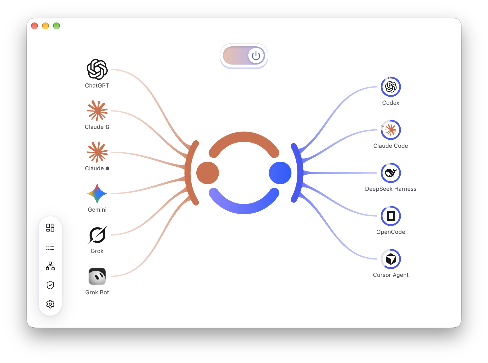

# Agent Remote Control（ARC）

**在 Claude 里规划，让本机 Codex 执行，自动接回结果，不用自己来回传话。**

[English](README.md) | **简体中文**

https://github.com/user-attachments/assets/bc58f15f-4d6e-4a0c-a78f-a7661e1ccf33

*30 秒介绍视频 · 支持声音播放。*

[下载 ARC](https://github.com/whzxc/agent-remote-control/releases) · [快速上手](docs/zh-CN/getting-started.md) · [文档](#文档)

## Claude + Codex：协作闭环（Loop）

在 claude.ai 的 Claude Code 会话里讨论和规划，网页、手机和桌面 App 都能打开。Claude 通过 ARC 读取当前文件、Git 改动和 Codex 任务，再把明确的工作派给本机 Codex。派发后 Claude 可以直接结束本轮；Codex 完成时，ARC 的通知会唤醒同一云端会话，让 Claude 审查改动并继续。离开键盘，也能继续推进。

Claude 使用远程链接并在本机批准接入。自动回访还需要发起方的 Claude Code 云端会话 ID，以及本机已登录的 Claude Code CLI。[建立闭环](docs/zh-CN/guides/claude.md)。

## ChatGPT Chat + Codex

GPT-6 Astra Pro 在 ChatGPT Chat 模式里可用，Codex 里没有。ARC 把两者接起来：Chat 负责深度推理，Codex 负责执行。使用已开放该选项的 ChatGPT Pro、Business 或 Enterprise 账号，默认使用远程链接并在本机批准。[接入 ChatGPT](docs/zh-CN/guides/chatgpt.md)。

查看 ARC 应用界面

## 开始使用

[安装 ARC](docs/zh-CN/installation.md)，打开应用并登录 Codex，然后选择在哪里使用。

- **本机模式：**选择「在这台电脑上」。ARC 自动添加已安装的 Claude Code；Claude 桌面版点击「安装扩展」，完成后重启 Claude。
- **创建中继：**选择「在手机和网页上 → 创建我的中继」，登录免费的 Cloudflare 账号，等待远程链接就绪。
- **共享中继：**已有共享链接时，选择「有共享链接？」并粘贴。部署者在 ARC 内只看得到电脑列表，但技术上可在 Cloudflare 后台看到经过中继的流量；仅加入你信任的人。

### 添加控制源：三步

1. 选择 Claude、ChatGPT 或其他控制源，复制远程链接。
2. 按面板内的路径，在控制源设置里添加该链接。
3. 回到 ARC，核对浏览器与批准卡片上的四位配对码，再批准。

连接完成后，复制试用提示，让 Codex 回复「连接成功」。[逐步上手](docs/zh-CN/getting-started.md)。自有地址和 OpenAI Secure Tunnel 位于**设置 → 远程链接 → 高级**。

需要本机 Agent 协助安装或配置：

> 在这台电脑上配置 Agent Remote Control，按照 https://raw.githubusercontent.com/whzxc/agent-remote-control/main/skills/arc-setup/SKILL.md 操作。

## 文档

- **开始：**[上手](docs/zh-CN/getting-started.md) · [概念](docs/zh-CN/concepts.md) · [自动配置](docs/zh-CN/auto-setup.md)
- **连接：**[Claude](docs/zh-CN/guides/claude.md) · [ChatGPT](docs/zh-CN/guides/chatgpt.md) · [其他客户端](docs/zh-CN/guides/other-clients.md) · [HTTPS 提供商](docs/zh-CN/guides/connections.md)
- **使用：**[常见问题](docs/zh-CN/faq.md) · [安装、更新、卸载](docs/zh-CN/installation.md) · [为什么做 ARC](docs/zh-CN/story.md)
- **参考（英文）：**[工具](docs/reference/tools.md) · [Agents](docs/reference/agents.md) · [CLI](docs/reference/cli.md) · [OAuth](docs/reference/oauth.md) · [订阅额度](docs/reference/subscriptions.md) · [Linux](docs/reference/linux.md)
- **维护：**[开发](docs/dev/development.md) · [架构](docs/dev/architecture.md) · [UI](docs/dev/ui.md) · [发布](docs/dev/release.md)

也支持 Notion、Slack、Cursor、GitHub Copilot、Raycast、Microsoft Copilot、Grok 和自定义 MCP 客户端；Pi、OpenCode 与其他 ACP Agent 可与 Codex 一起使用。

本机 ChatGPT Desktop 面板由独立的 [Usage](https://github.com/whzxc/chatgpt-usage-plugin) 和 [Kanban](https://github.com/whzxc/chatgpt-kanban-plugin) 插件仓库维护。

## 许可证

[MIT](LICENSE)。
